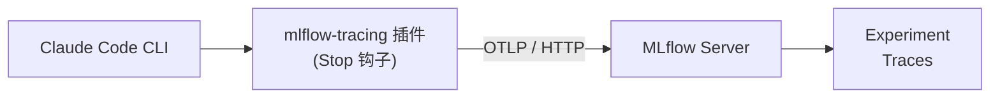
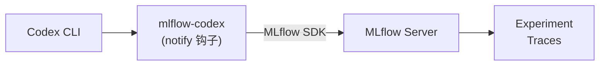
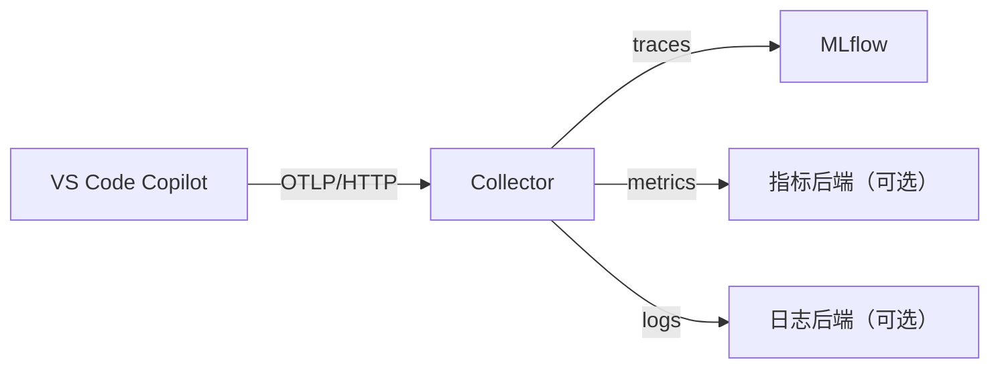
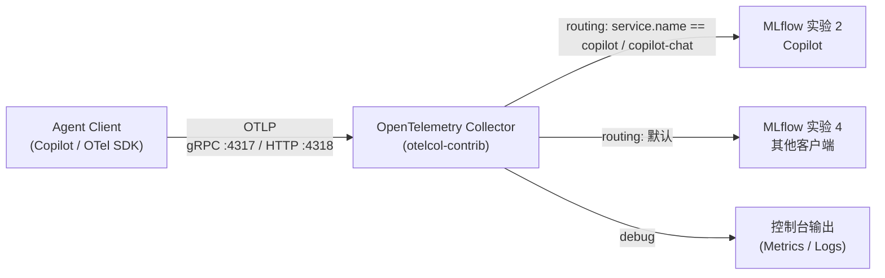

# LLM 和 Agent 可观测性环境配置

本文介绍如何为 LLM / Agent 客户端配置可观测性，并把遥测数据汇入 MLflow 平台。全文按“为什么需要可观测性 → MLflow 简介 → 官方已支持客户端快速接入 → 官方暂不支持客户端接入 → ZCode 暂不接入的调研 → 常见问题排查 → 安全与合规 → 相关资料”的顺序展开。

> ℹ️ 本文中客户端侧（Claude Code、Codex、VS Code / Copilot 等）的配置项与行为会随客户端版本变化，具体以各客户端官方文档为准；Collector 相关的配置与命令对应 `otelcol-contrib` v0.163.1。

阅读后你应当能够：

- 理解 LLM / Agent 可观测性与传统监控的差异，了解为什么需要 LLM / Agent 可观测；
- 了解 MLflow 可观测平台及其能力；
- 完成 Claude Code CLI、Codex 这些 MLflow 官方已经支持的 Agent Client 的快速接入，并确认 trace 已出现在正确的实验中；
- 针对 MLflow 官方暂不支持的 Agent Client（以 GitHub Copilot 为例），选择初级（本地调试）或进阶（经 Collector 集中采集）方案；
- 理解 `Agent Client → OpenTelemetry Collector → MLflow` 可观测平台架构；
- 部署并配置 OpenTelemetry Collector，按客户端分流到不同的 MLflow 实验；
- 了解 ZCode 为何暂不接入；

本文覆盖的客户端及其接入方式速览：

| 客户端 | 接入方式 | 是否经过 Collector | MLflow 官方支持 | 接入步骤 |
| --- | --- | --- | --- | --- |
| Claude Code CLI | 官方插件 `mlflow-tracing` | ❌ 直连 MLflow | ✅ | [3.1 Claude Code CLI](#31-claude-code-cli) |
| Codex CLI | 官方插件 `@mlflow/codex` | ❌ 直连 MLflow | ✅ | [3.2 Codex CLI](#32-codex-cli) |
| GitHub Copilot | VS Code 内置 OTel 支持 | ✅ 经 Collector 集中采集 | ❌ | [4. MLflow 官方暂不支持的 Agent Client 接入](#4-mlflow-官方暂不支持的-agent-client-接入) |
| ZCode | 内置 OTel 运行时 | — 暂不接入 | ❌ | [5. ZCode 接入 MLflow 的相关调研：暂不接入](#5-zcode-接入-mlflow-的相关调研暂不接入) |

官方已支持的客户端由各自的本地配置（实验 ID）决定写入哪个实验；Copilot 没有官方插件，
通过标准 OpenTelemetry 环境变量上报，由 Collector 按 `service.name` 分流到不同实验。

示例 Collector 配置位于 [`otelcol-contrib/config-mlflow-routing.yaml`](./otelcol-contrib/config-mlflow-routing.yaml)。

---

## 目录

- [LLM 和 Agent 可观测性环境配置](#llm-和-agent-可观测性环境配置)
  - [目录](#目录)
  - [1. 为什么需要可观测性](#1-为什么需要可观测性)
  - [2. MLflow 简介](#2-mlflow-简介)
  - [3. MLflow 官方已支持的 Agent Client 快速接入](#3-mlflow-官方已支持的-agent-client-快速接入)
    - [3.1 Claude Code CLI](#31-claude-code-cli)
      - [3.1.1 前置条件](#311-前置条件)
      - [3.1.2 第一步：安装插件](#312-第一步安装插件)
      - [3.1.3 第二步：运行配置向导](#313-第二步运行配置向导)
      - [3.1.4 第三步：补充认证信息](#314-第三步补充认证信息)
      - [3.1.5 第四步：验证](#315-第四步验证)
      - [3.1.6 配置项说明](#316-配置项说明)
        - [3.1.6.1 关于实验 ID](#3161-关于实验-id)
        - [3.1.6.2 关于模型价格目录](#3162-关于模型价格目录)
    - [3.2 Codex CLI](#32-codex-cli)
      - [3.2.1 前置条件](#321-前置条件)
      - [3.2.2 第一步：安装插件](#322-第一步安装插件)
      - [3.2.3 第二步：运行配置向导](#323-第二步运行配置向导)
      - [3.2.4 第三步：补充认证信息](#324-第三步补充认证信息)
      - [3.2.5 第四步：验证](#325-第四步验证)
      - [3.2.6 可选：改用原生 OTLP 上报](#326-可选改用原生-otlp-上报)
    - [3.3 其他官方支持的客户端](#33-其他官方支持的客户端)
  - [4. MLflow 官方暂不支持的 Agent Client 接入](#4-mlflow-官方暂不支持的-agent-client-接入)
    - [4.1 初级：启用 GitHub Copilot 本地 Agent Debug Logs](#41-初级启用-github-copilot-本地-agent-debug-logs)
      - [4.1.1 Agent Debug Logs](#411-agent-debug-logs)
      - [4.1.2 Chat Debug View](#412-chat-debug-view)
    - [4.2 进阶：GitHub Copilot 通过 OpenTelemetry Collector 接入 MLflow](#42-进阶github-copilot-通过-opentelemetry-collector-接入-mlflow)
      - [4.2.1 Agent Client → OpenTelemetry Collector → MLflow 架构介绍](#421-agent-client--opentelemetry-collector--mlflow-架构介绍)
        - [4.2.1.1 OpenTelemetry 基础](#4211-opentelemetry-基础)
        - [4.2.1.2 Collector 的组件模型](#4212-collector-的组件模型)
        - [4.2.1.3 数据流与实验路由](#4213-数据流与实验路由)
      - [4.2.2 OpenTelemetry Collector 部署与配置](#422-opentelemetry-collector-部署与配置)
        - [4.2.2.1 下载与安装](#4221-下载与安装)
        - [4.2.2.2 配置详解](#4222-配置详解)
          - [receivers（接收器）](#receivers接收器)
          - [processors（处理器）](#processors处理器)
          - [connectors（连接器）](#connectors连接器)
          - [exporters（导出器）](#exporters导出器)
          - [extensions（扩展）](#extensions扩展)
          - [service（服务）](#service服务)
          - [新增一个 MLflow 实验的路由](#新增一个-mlflow-实验的路由)
        - [4.2.2.3 启动与验证](#4223-启动与验证)
    - [4.3 GitHub Copilot 接入 MLflow](#43-github-copilot-接入-mlflow)
      - [4.3.1 VS Code 设置](#431-vs-code-设置)
      - [4.3.2 配置项](#432-配置项)
      - [4.3.3 环境变量与设置项的优先级](#433-环境变量与设置项的优先级)
      - [4.3.4 Copilot 专用环境变量](#434-copilot-专用环境变量)
      - [4.3.5 服务名与路由](#435-服务名与路由)
      - [4.3.6 隐私提示](#436-隐私提示)
    - [4.4 Copilot SDK](#44-copilot-sdk)
  - [5. ZCode 接入 MLflow 的相关调研：暂不接入](#5-zcode-接入-mlflow-的相关调研暂不接入)
  - [6. 常见问题排查](#6-常见问题排查)
    - [6.1 Claude Code](#61-claude-code)
    - [6.2 Codex](#62-codex)
    - [6.3 Collector](#63-collector)
    - [6.4 GitHub Copilot](#64-github-copilot)
  - [7. 安全与合规](#7-安全与合规)
  - [8. 相关资料](#8-相关资料)
    - [MLflow](#mlflow)
    - [OpenTelemetry](#opentelemetry)
    - [Codex](#codex)
    - [GitHub Copilot 与 VS Code](#github-copilot-与-vs-code)

---

## 1. 为什么需要可观测性

传统软件的每一次行为都能追溯到某一条代码路径；LLM 和 Agent 不能。我们无法把模型的行为与输出归因到某一份训练数据或某一处权重，而这些系统已经在接触最敏感的数据，并且有权代我们执行关键动作。

更麻烦的是，它们几乎不报错：同样的输入重采样一次就是另一个答案，幻觉、工具参数传错、该调工具时没调用——HTTP 200，日志干净，只有用户看得出不对。

借助可观测性，至少能解决下面两个问题：

- **它做了什么**：把“这个回答不对”还原成一条完整链路——每一步的输入输出、检索命中了什么、为什么这么决策、工具调用成功还是失败。没有这条链路，排障只能靠猜。
- **它花了多少**：token 用量与调用费用，否则多步 Agent 的循环会在无人察觉时把预算烧完。

一句话：传统可观测性问的是“服务有没有挂”，LLM 和 Agent 可观测性问的是“Agent 做了什么、花了多少”。当模型接触敏感数据、又有权代我们行动时，可观测性就不再只是优化手段，而是授权的前提。

---

## 2. MLflow 简介

经过对比，我们最终选择 **MLflow** 作为 LLM 和 Agent 的可观测平台。平台已完成安装和配置，无需个人重复部署；有需要的同事可联系**研发管理办公室**开通个人账号。当前平台已配置个人账号之间的数据相互隔离。

**平台测试账号**（仅供体验与联调）：

- URL: `http://10.203.2.87:5000`
- 用户名：`foxit`
- 密码：请向**研发管理办公室**索取

> 该账号为**共享测试账号**，多人共用，登录后看到的是同一账号下的实验与 trace；
> 正式使用请按上文联系研发管理办公室开通**个人账号**，以获得数据隔离。
>
> ⚠️ 共享账号的口令不写入文档、代码与配置文件，以免随文档流转扩散；请通过
> 办公渠道索取，并仅用于体验与联调。

MLflow 在本场景中主要提供：

- **Trace**：记录一次会话的完整调用树，包括提示词、响应、工具调用、子 Agent 与耗时；
- **Token 与成本**：按模型统计 token 用量并估算费用；
- **实验（Experiment）**：按项目、团队或客户端组织 trace，便于检索与对比。

了解更多信息，请阅读 [MLflow 官方文档](https://mlflow.org/docs/latest/genai/)。

> ⚠️ **重要限制**：MLflow 的 OTLP 接入端点**只支持 Traces，且只支持 OTLP/HTTP**（不支持 OTLP/gRPC）。
> 因此本示例中 Traces 通过 `otlp_http` 导出器发往 MLflow，Metrics / Logs 走 `debug` 输出到控制台。
>
> ⚠️ **版本要求**：OTLP trace 摄取需要 MLflow **3.6.0 及以上**，且服务端使用 SQL 后端存储
> （SQLite / PostgreSQL / MySQL）；示例配置中的 `compression: gzip` 还需要 **3.7.0 及以上**，
> 更早版本请删除该行。

| 信号 | MLflow 端点 | 是否支持 |
| --- | --- | --- |
| Traces | `http://10.203.2.87:5000/v1/traces` | ✅ 支持 |
| Metrics | `http://10.203.2.87:5000/v1/metrics` | ❌ 不支持 |
| Logs | `http://10.203.2.87:5000/v1/logs` | ❌ 不支持 |

参考资料：[MLflow OpenTelemetry 文档](https://mlflow.org/docs/latest/genai/tracing/opentelemetry/ingest)。

如需持久化 Metrics / Logs，请把对应 pipeline 的 exporter 替换为其他后端
（如 Prometheus、Loki 或另一个 OTLP 后端）。

---

## 3. MLflow 官方已支持的 Agent Client 快速接入

MLflow 官方为一批 Agent Client 直接提供了接入插件，接入成本最低：安装插件、配置 tracking URI 与实验 ID 即可，
**无需自行搭建 Collector**。本节覆盖 Claude Code CLI 与 Codex CLI，其他官方支持的客户端见 [3.3 其他官方支持的客户端](#33-其他官方支持的客户端)。

### 3.1 Claude Code CLI

Claude Code 通过 MLflow 官方插件 `mlflow-tracing` 接入，不需要本地安装 Python 或 MLflow SDK。
插件注册 `Stop` 钩子，在每轮回答结束时读取会话记录，并把整棵 span 树上报到 MLflow。



#### 3.1.1 前置条件

- 已安装并可使用 Claude Code CLI；
- 已开通 MLflow 个人账号，并拿到 tracking URI；
- 已有一个实验的**整数 ID**，或准备让插件按名称创建实验；
- 本机可以访问 MLflow Server。

#### 3.1.2 第一步：安装插件

在**终端**中执行（不要在 Claude Code 会话内执行）：

```bash
claude plugin marketplace add mlflow/mlflow --sparse .claude-plugin
claude plugin install mlflow-tracing@mlflow-plugins
```

> ⚠️ 不要在 Claude Code 内使用 `/plugin marketplace add mlflow/mlflow`。
> 该命令会克隆完整的 `mlflow/mlflow` 仓库，体积大、经常超时。
> 使用上面带 `--sparse .claude-plugin` 的终端命令，只拉取插件目录。

安装完成后运行 `claude` 启动（或重启）Claude Code，使插件生效。

#### 3.1.3 第二步：运行配置向导

在 Claude Code 中执行：

```text
/mlflow-tracing:setup
```

向导会要求提供三个值：

| 配置项 | 说明 |
| --- | --- |
| Tracking URI | MLflow Server 地址，通常为绝对的 `http://` 或 `https://` URL；Databricks 场景可填 `databricks` 或 `databricks://...` |
| Experiment | 实验的整数 ID（`--experiment-id`），或实验名称（`--experiment-name`）；两者只能选一个 |
| Scope | 配置写入的位置：project 或 user |

Scope 对应关系：

| Scope | 写入文件 | 适用场景 |
| --- | --- | --- |
| `project` | `./.claude/settings.json` | 只对当前仓库生效，可随仓库共享非敏感配置 |
| `user` | `~/.claude/settings.json` | 对所有仓库生效，适合放置个人凭据 |

向导只询问上表的三个必填值。如使用 Databricks Unity Catalog，可在 setup 命令中追加
`--trace-location catalog.schema.table_prefix`；需要指定 MLflow workspace 时追加
`--workspace <name>`。两者分别对应 `MLFLOW_TRACE_LOCATION` 和 `MLFLOW_WORKSPACE`，
不配置时使用服务端默认值。

> 如果使用 `--experiment-name`，向导会在配置阶段调用 MLflow 按名称解析或创建实验，
> 因此需要提前在 `~/.bash_profile` 中设置认证变量
> （`MLFLOW_TRACKING_USERNAME` / `MLFLOW_TRACKING_PASSWORD`，或 `MLFLOW_TRACKING_TOKEN`）
> 并让它对启动 Claude Code 的进程生效（见 [3.1.4](#314-第三步补充认证信息)），
> 否则这一步会因 401 失败。使用 `--experiment-id` 时不会联网解析，
> 可以先完成向导再补充凭据。
>
> ⚠️ 插件只识别 `./.claude/settings.json`（project）和 `~/.claude/settings.json`（user）。
> `.claude/settings.local.json` 虽然会被 Claude Code 加载，但插件不会直接读取它，
> 排查问题时容易误判。请统一使用上面两个文件。

#### 3.1.4 第三步：补充认证信息

配置向导只写入 tracing 相关键，不处理用户名和密码。若 MLflow 开启了 Basic Auth，
**凭据写入本机 shell 启动文件（`~/.bash_profile`），不要写进 settings 文件**：
project scope 的 `settings.json` 通常随仓库提交，写进去等于把密码提交到版本库。

```bash
# ~/.bash_profile
export MLFLOW_TRACKING_USERNAME="<username>"
export MLFLOW_TRACKING_PASSWORD="<password>"
# 或使用 Token：export MLFLOW_TRACKING_TOKEN="<token>"
```

改完执行 `source ~/.bash_profile`（或新开一个终端）使其生效。

环境变量的优先级高于 settings 文件，settings 只需保留非敏感键：

```json
{
  "env": {
    "MLFLOW_CLAUDE_TRACING_ENABLED": "true",
    "MLFLOW_TRACKING_URI": "http://10.203.2.87:5000/",
    "MLFLOW_EXPERIMENT_ID": "<experiment-id>"
  }
}
```

凭据只存在于本机用户目录，不随仓库发布。若终端启动的不是登录 shell（部分 Linux 发行版），
`~/.bash_profile` 不会被读取，此时改写入 `~/.bashrc`；企业环境也可由 systemd
`EnvironmentFile`、Kubernetes Secret、密钥管理服务统一注入。

> ⚠️ 凭据必须注入到**启动 `claude` 的进程环境**：改完 `~/.bash_profile` 要 `source`
> 或新开终端使其生效，并重启 `claude`；在 Claude Code 会话内 `export` 不会影响
> 已经启动的进程。

如果使用实验名称而不是 ID：

```json
{
  "env": {
    "MLFLOW_CLAUDE_TRACING_ENABLED": "true",
    "MLFLOW_TRACKING_URI": "http://10.203.2.87:5000/",
    "MLFLOW_EXPERIMENT_NAME": "claude-code"
  }
}
```

`MLFLOW_EXPERIMENT_ID` 与 `MLFLOW_EXPERIMENT_NAME` 二选一。配置 CLI 不允许同时传入；
若通过不同配置层或环境变量同时提供了两者，运行时以 ID 为准。

使用向导的 `--experiment-name` 时，插件会先按名称查找实验（不存在则创建），
再把解析出的整数 ID 与名称一起写入配置，因此 `.claude/settings.json` 中会同时出现两者；
手工配置时只写 `MLFLOW_EXPERIMENT_NAME` 也可以。

#### 3.1.5 第四步：验证

```text
/mlflow-tracing:status
```

正常情况下会看到：

```text
MLflow Tracing Status

  Enabled: true
  Source: project
  Settings file: /path/to/project/.claude/settings.json
  Tracking URI: http://10.203.2.87:5000/
  Experiment ID: <experiment-id>
  Experiment name: <experiment-name 或 not set>
  Workspace: not set
```

`Source` 表示配置来源：`environment`（环境变量）、`project`、`user` 或 `none`。
若为 `none`，说明插件没有读到任何配置。

然后运行一次简短的 Claude Code 会话并退出，打开 MLflow 中对应实验的 **Traces** 页面，
应能看到这次会话的 trace。

> Trace 由 `Stop` 钩子上报。若刚结束会话仍未看到，先刷新页面；
> 仍无数据时按 [6.1 Claude Code](#61-claude-code) 逐项排查。

#### 3.1.6 配置项说明

| 环境变量 | 必填 | 说明 |
| --- | --- | --- |
| `MLFLOW_CLAUDE_TRACING_ENABLED` | 是 | 总开关。`true` / `1` / `yes` 为开启（不区分大小写） |
| `MLFLOW_TRACKING_URI` | 是 | MLflow Server 地址，通常为绝对的 `http://` 或 `https://` URL；Databricks 场景可用 `databricks` 或 `databricks://<profile>` |
| `MLFLOW_EXPERIMENT_ID` | 二选一 | 实验的**整数 ID**，插件原样使用，不做名称解析 |
| `MLFLOW_EXPERIMENT_NAME` | 二选一 | 实验名称；不存在时自动创建，存在时复用 |
| `MLFLOW_TRACKING_USERNAME` | 视部署而定 | Basic Auth 用户名 |
| `MLFLOW_TRACKING_PASSWORD` | 视部署而定 | Basic Auth 密码 |
| `MLFLOW_TRACKING_TOKEN` | 视部署而定 | Bearer Token；与用户名/密码二选一 |
| `MLFLOW_TRACE_LOCATION` | 否 | Databricks Unity Catalog 的 trace 存储位置，格式 `catalog.schema.table_prefix` |
| `MLFLOW_WORKSPACE` | 否 | MLflow workspace 名称；未设置时使用服务端默认 workspace |
| `MLFLOW_MODEL_CATALOG_URI` | 否 | 模型价格目录的基地址，默认使用 MLflow 官方目录 |
| `MLFLOW_MODEL_CATALOG_CACHE_TTL` | 否 | 价格缓存秒数，默认 `86400`；`0` 表示不读取缓存，每次都重新拉取 |

> ⚠️ 上表中三个凭据项（`MLFLOW_TRACKING_USERNAME` / `MLFLOW_TRACKING_PASSWORD` /
> `MLFLOW_TRACKING_TOKEN`）应只通过 `~/.bash_profile` 等本机 shell 启动文件
> 或密钥管理服务提供，不要写进 `settings.json`。同名时环境变量优先于 settings 文件
> （详见 [3.1.4](#314-第三步补充认证信息)）。

##### 3.1.6.1 关于实验 ID

`MLFLOW_EXPERIMENT_ID` 必须是实验的**整数 ID**，例如 `1`、`42`。
JSON 中需要写成字符串（环境变量只能是字符串），但内容必须是纯数字。

实验 ID 可以从 MLflow UI 的实验页 URL 中获取（`experiments/` 后面的数字），
也可以在已配置 MLflow 的环境中执行 `mlflow experiments search` 查询。

> `--experiment-id` 只接受**已存在**的实验 ID，插件不会解析名称，也不会自动创建实验；
> 把名称传给该选项不会立即报错，但 trace 最终无法写入你预期的位置。
> 需要按名称定位或让插件自动创建实验时，请改用 `--experiment-name`
> （对应 `MLFLOW_EXPERIMENT_NAME`）。

##### 3.1.6.2 关于模型价格目录

`MLFLOW_MODEL_CATALOG_URI` 和 `MLFLOW_MODEL_CATALOG_CACHE_TTL` **不是必填项**，
不配置也能正常统计常见 Anthropic 模型的成本：

1. 插件默认从 MLflow 官方发布的模型目录拉取 `anthropic.json`；
2. 拉取结果缓存在 `~/.mlflow/model_catalog_cache/anthropic.json`，默认缓存 24 小时；
3. 拉取失败或未命中时，回退到插件内置的 Anthropic 价格快照。

只有在以下场景才需要自行配置：

- **离线 / 内网环境**：把价格文件放到本地目录，并将 `MLFLOW_MODEL_CATALOG_URI` 指向该目录，
  例如 `file:///opt/mlflow/model-catalog`；
- **自定义价格**：需要覆盖官方价格时，维护自己的 `anthropic.json`；
- **关闭远程查询**：把 `MLFLOW_MODEL_CATALOG_URI` 设为空字符串。

注意：插件只会读取基地址下的 `anthropic.json`，因此该目录中必须直接存在这个文件；
目录结构不是按 provider 分子目录。

```text
model-catalog/
└── anthropic.json
```

`MLFLOW_MODEL_CATALOG_CACHE_TTL` 单位为秒，默认 `86400`；设为 `0` 表示每次都重新读取，
适合调整价格后立即验证。拉取失败的结果也会按同一 TTL 缓存，避免离线环境每次启动都等待
网络超时。未知模型没有价格数据，费用会显示为空，而不是 `0`。

### 3.2 Codex CLI

Codex CLI 通过 MLflow 官方 npm 包 `@mlflow/codex` 接入，同样不需要本地安装 Python 或 MLflow SDK。
插件向 Codex 的 `config.toml` 注册 `notify` 钩子，Codex 在**每轮对话结束**时调用该钩子，
把该轮的提示词、响应、工具调用与 token 用量上报到 MLflow——**每轮一条 trace，无需等会话结束**。



> 与 Claude Code 相同，Codex 直接上报 MLflow，不经过 Collector，
> 因此不受 [4.2.1.3 数据流与实验路由](#4213-数据流与实验路由) 中 routing 规则的影响，
> 写入哪个实验由本节的配置决定。

#### 3.2.1 前置条件

- 已安装并可使用 Codex CLI（`codex` 命令可用）；
- Node.js 18 或更新版本（MLflow 官方要求）；
- 已开通 MLflow 个人账号，并拿到 tracking URI；
- 已有一个实验的**整数 ID**（Codex 插件不接受实验名称，也不会自动创建实验）；
- 本机可以访问 MLflow Server。

#### 3.2.2 第一步：安装插件

```bash
npm install -g @mlflow/codex
```

安装后提供 `mlflow-codex` 命令。不想全局安装时可以用 `npx` 调用，例如
`npx @mlflow/codex setup`，后续命令同样适用。

```bash
which mlflow-codex   # 确认命令已进入 PATH
```

#### 3.2.3 第二步：运行配置向导

```text
mlflow-codex setup
```

向导依次询问三项：

| 配置项 | 说明 |
| --- | --- |
| Scope | 配置写入的位置：`Project`（`./.codex/`，默认）或 `User`（`~/.codex/`） |
| MLflow tracking URI | MLflow Server 地址，默认 `http://localhost:5000` |
| MLflow experiment ID | 实验的整数 ID，默认 `0` |

Scope 对应关系：

| Scope | 写入文件 | 适用场景 |
| --- | --- | --- |
| `Project` | `./.codex/config.toml`、`./.codex/mlflow-tracing.json` | 只对当前项目生效，配置可随项目共享 |
| `User` | `~/.codex/config.toml`、`~/.codex/mlflow-tracing.json` | 对所有项目生效 |

需要脚本化或批量部署时使用非交互模式：

```bash
mlflow-codex setup -y --tracking-uri http://10.203.2.87:5000 --experiment-id <experiment-id>
```

| 参数 | 说明 |
| --- | --- |
| `--project` / `-p` | 写入 `./.codex/`，跳过 Scope 询问 |
| `--non-interactive` / `-y` | 全部使用参数值或默认值，不进入交互 |
| `--tracking-uri <url>` | 指定 tracking URI |
| `--experiment-id <id>` | 指定实验的整数 ID |
| `--trace-location <loc>` | Databricks Unity Catalog 的 trace 存储位置，格式 `catalog.schema.table_prefix` |

向导写入 `.codex/config.toml`：

```toml
notify = ["mlflow-codex", "notify-hook"]
```

以及 `.codex/mlflow-tracing.json`（保存 MLflow 配置，让钩子无需 shell 变量即可运行）：

```json
{
  "trackingUri": "http://10.203.2.87:5000",
  "experimentId": "<experiment-id>"
}
```

> ⚠️ setup **不会覆盖已存在的 `notify = ...` 条目**，以免破坏你原有的配置。
> 如果 `config.toml` 里已经注册了其他通知器，setup 会跳过这一步，钩子不会被注册；
> 此时需要在 `config.toml` 中自行加入 `notify = ["mlflow-codex", "notify-hook"]`
> （`notify` 只接受一个条目，如与原通知器冲突，需要自行取舍）。
>
> ⚠️ 与 Claude Code 插件不同，Codex 侧**只接受已存在实验的整数 ID**，
> 不支持按名称解析，也不会自动创建实验。请先在 MLflow UI 中建好实验并取其 ID。

每轮 trace 的根 span 名为 `codex_conversation`，并带有 `mlflow.trace.session`
（Codex 的 `thread-id`，用于在 MLflow 中把同一会话的多个轮次串起来）与
`mlflow.trace.user`（发起进程的操作系统用户名）两项元数据。

#### 3.2.4 第三步：补充认证信息

若 MLflow 开启了 Basic Auth，把凭据写入 `~/.bash_profile`（做法与
[3.1.4](#314-第三步补充认证信息) 一致，同样不要写进任何随仓库提交的文件）：

```bash
# ~/.bash_profile
export MLFLOW_TRACKING_USERNAME="<username>"
export MLFLOW_TRACKING_PASSWORD="<password>"
# 或使用 Token：export MLFLOW_TRACKING_TOKEN="<token>"
```

改完执行 `source ~/.bash_profile`（或新开一个终端）再启动 `codex`。

| 环境变量 | 必填 | 说明 |
| --- | --- | --- |
| `MLFLOW_TRACKING_URI` | 否 | 覆盖 `mlflow-tracing.json` 中的 `trackingUri` |
| `MLFLOW_EXPERIMENT_ID` | 否 | 覆盖 `mlflow-tracing.json` 中的 `experimentId` |
| `MLFLOW_TRACKING_USERNAME` | 视部署而定 | Basic Auth 用户名 |
| `MLFLOW_TRACKING_PASSWORD` | 视部署而定 | Basic Auth 密码 |
| `MLFLOW_TRACKING_TOKEN` | 视部署而定 | Bearer Token；与用户名/密码二选一 |
| `MLFLOW_WORKSPACE` | 否 | MLflow workspace 名称；未设置时使用服务端默认 workspace |
| `MLFLOW_TRACE_LOCATION` | 否 | Databricks Unity Catalog 的 trace 存储位置，格式 `catalog.schema.table_prefix` |

配置解析顺序（先命中者优先，可用于临时切换环境）：

1. 环境变量 `MLFLOW_TRACKING_URI` / `MLFLOW_EXPERIMENT_ID`；
2. 项目级 `./.codex/mlflow-tracing.json`；
3. 用户级 `~/.codex/mlflow-tracing.json`。

```bash
# 单次覆盖，例如临时切换实验
MLFLOW_EXPERIMENT_ID=7 codex "帮我重构这个函数"
```

> ⚠️ `mlflow-tracing.json` 只保存 tracking URI 与实验 ID，不保存凭据；凭据一律通过环境变量注入。
> 项目级 `.codex/` 通常随仓库提交，不要在其中写入任何凭据。

#### 3.2.5 第四步：验证

```bash
codex "帮我重构这个函数"
```

每轮对话结束后，打开 MLflow 中对应实验的 **Traces** 页面，应能看到这一轮的 trace。
排查时先确认下面四项：

- 配置文件（`./.codex/config.toml` 或 `~/.codex/config.toml`）中存在
  `notify = ["mlflow-codex", "notify-hook"]`；
- `which mlflow-codex` 能解析到路径；
- `mlflow-tracing.json` 存在，且 `trackingUri` / `experimentId` 指向预期位置；
- Node.js 版本满足要求，且本机能访问 MLflow Server。

> 仍无数据时按 [6.2 Codex](#62-codex) 逐项排查。

#### 3.2.6 可选：改用原生 OTLP 上报

Codex CLI 也支持在 `config.toml` 中配置原生 OpenTelemetry 上报：

```toml
[otel]
exporter = { otlp-http = {
  endpoint = "http://10.203.2.87:5000/v1/traces",
  protocol = "binary",
  headers = { "x-mlflow-experiment-id" = "<experiment-id>" }
}}
```

> 官方说明：Codex 的原生 OTLP trace 捕获的是**内部执行细节**（websocket 连接、请求处理、
> 工具调度），而不是干净的对话调用链。需要提示词、响应与工具结果的会话视图时，
> 应使用上面的 `notify` 钩子方式；两者可以同时启用。
>
> 把 `endpoint` 指向 Collector 的 OTLP/HTTP 端口（`4318`）也可以让 Codex 数据经 Collector
> 统一采集，但此时写入哪个实验由 Collector 侧的 routing 规则决定，需按 Codex 实际上报的
> 资源属性新增规则（方法见 [4.2.2.2 新增一个 MLflow 实验的路由](#新增一个-mlflow-实验的路由)）。

### 3.3 其他官方支持的客户端

MLflow 官方还支持 Gemini CLI、OpenCode、OpenHands、Qwen Code、Hermes Agent、Omnigent 等客户端，
接入思路与本节一致，可参考
[MLflow 官方集成列表](https://mlflow.org/docs/latest/genai/tracing/integrations/) 自行扩展。

---

## 4. MLflow 官方暂不支持的 Agent Client 接入

对于 MLflow 官方尚未提供插件的 Agent Client（典型代表是 **GitHub Copilot**），
需要自行接通遥测数据。可按下述两个层次推进，从轻到重：

- **初级（4.1）本地调试**：启用客户端自带的调试日志（如 Copilot 的 Agent Debug Logs），
  排查单次会话的问题，不产生集中存储；
- **进阶（4.2、4.3）集中采集**：把客户端的 OpenTelemetry 数据经 Collector 转发到 MLflow，
  支持跨会话查询与长期留存。

> 本节以 GitHub Copilot 为例；其他官方不支持的客户端若已内置 OTel 上报能力，
> 也可套用「进阶」方案，只需在 Collector 中按 `service.name` 新增一条 routing 规则。

### 4.1 初级：启用 GitHub Copilot 本地 Agent Debug Logs

本地调试使用 VS Code 内置视图，完全在本地查看，不产生集中存储，
适合定位单次会话的执行步骤与报错。

#### 4.1.1 Agent Debug Logs

查看 Agent 的执行步骤、工具调用、子 Agent、token 用量和错误。
通过命令面板（`Cmd+Shift+P` / `Ctrl+Shift+P`）运行：

```text
Developer: Open Agent Debug Logs
```

Agent Debug Logs 目前为 Preview。按会话类型开启对应设置：

| 会话类型 | 设置项 |
| --- | --- |
| Agent Host | `chat.agentHost.agentDebugLog.enabled` |
| Local harness | `github.copilot.chat.agentDebugLog.fileLogging.enabled` |

开启后重新加载窗口并复现问题。需要保存记录时，在 Agent Debug Logs 中使用 **Export** 导出，
再通过 **Import** 查看。

> 调试视图和导出的日志可能包含提示词、源代码、文件路径和工具输入输出。
> 即使 OTel 导出关闭，Agent Debug Logs 仍可能在本地记录完整提示词与响应；
> 这些内容不会自动进入 MLflow，但分享前仍应先审查，并避免包含凭据或敏感数据。

#### 4.1.2 Chat Debug View

检查模型请求中的指令、上下文、工具定义及响应。运行：

```text
Developer: Show Chat Debug View
```

登录、连接或扩展错误可在 **View → Output → GitHub Copilot** 查看。
必要时临时将相关扩展日志级别设为 `Trace`，排查后恢复 `Info`。

使用说明见 [VS Code：Debug chat interactions](https://code.visualstudio.com/docs/agents/agent-troubleshooting/chat-debug-view)，
更多日志排查方式见 [GitHub Copilot for VS Code：Viewing logs](https://docs.github.com/en/copilot/how-tos/troubleshoot-copilot/view-logs?tool=vscode)。

### 4.2 进阶：GitHub Copilot 通过 OpenTelemetry Collector 接入 MLflow

需要跨会话查询、集中留存或质量评估时，可把 Copilot 的 OpenTelemetry 数据经 Collector 转发到 MLflow。
本小节先介绍整体架构与 Collector 的部署配置，具体的客户端接入在 [4.3 GitHub Copilot 接入 MLflow](#43-github-copilot-接入-mlflow)。



> MLflow 只接收 traces，不接收 metrics 或 logs。需要这两类信号时，应在 Collector 中另行配置后端。

#### 4.2.1 Agent Client → OpenTelemetry Collector → MLflow 架构介绍

Collector 位于应用与 MLflow 之间，负责接收、加工、按客户端分流并转发数据。

##### 4.2.1.1 OpenTelemetry 基础

OpenTelemetry（简称 OTel）是 CNCF 旗下的开源可观测性标准，提供一套**统一的 API、SDK 和数据协议（OTLP）**，
用于生成、采集和传输三类遥测数据：

| 信号 | 英文 | 说明 |
| --- | --- | --- |
| 链路追踪 | Traces | 记录一次请求在多个服务之间的完整调用路径与耗时 |
| 指标 | Metrics | 记录可聚合的数值，如 QPS、延迟、内存占用 |
| 日志 | Logs | 记录离散的事件文本 |

在 OTel 出现之前，可观测性通常面临几个痛点：

- **厂商锁定**：每种后端（Jaeger、Zipkin、Datadog、MLflow 等）都有自己的 SDK 和数据格式，换后端就要改代码。
- **接入成本高**：应用要同时对接多个后端，就要维护多套埋点代码。
- **数据格式不统一**：不同语言、不同框架的埋点数据难以互通。

OTel 通过**标准化**解决这些问题：

- 应用只对接 OTel SDK，用统一的 OTLP 协议上报数据；
- 后端如何切换、数据如何加工，全部交给 Collector 处理，**应用代码无需改动**。

一句话概括：**OTel 让「应用产生数据」与「数据发往哪里」解耦。**

##### 4.2.1.2 Collector 的组件模型

Collector 的配置由以下几类组件组成：

```text
receivers  →  processors  →  exporters
（接收数据）   （加工数据）     （发送数据）
                  │
              connectors
          （连接两条 pipeline）
```

`service.pipelines` 负责把组件组装成一条条数据管道。`extensions` 提供健康检查、
性能分析等辅助能力，不参与数据处理链路。

##### 4.2.1.3 数据流与实验路由

本示例的完整数据流如下：



各环节职责：

1. **Agent Client（应用侧）**
   应用通过 OTel SDK 产生 Traces / Metrics / Logs，并按 OTLP 协议上报到 Collector。
   应用只需要知道 Collector 的地址，不需要知道 MLflow 的存在。

2. **OpenTelemetry Collector（中间层）**
   接收数据 → 加工数据（限流、批处理、补充属性）→ 按规则分流 → 转发数据。
   它是整个链路的中枢，负责解耦应用与后端。

3. **MLflow（后端）**
   接收 Collector 转发过来的 Trace 数据并存储、展示。

当前配置按资源属性 `service.name` 分流：

| `service.name` | 目标 pipeline | MLflow 实验 ID |
| --- | --- | --- |
| `copilot` / `copilot-chat` | `traces/copilot` | `2` |
| 其他（未匹配） | `traces/default` | `4` |

> 表中的实验 ID `2` / `4` 只是本示例的取值，部署前请替换为自己环境中的实验 ID。
> 示例中的 `10.203.2.87:5000` 也是内网 MLflow 地址，其他环境请替换为实际地址。
>
> Copilot 的默认服务名是 `copilot-chat`，配置会直接命中实验 2；
> 若显式设置了 `OTEL_SERVICE_NAME=copilot`，同样命中实验 2。
>
> Claude Code 与 Codex 通过官方插件直接上报 MLflow，不经过 Collector，因此不受上述 routing 规则影响；
> 它们写入的实验由各自的插件配置（实验 ID）决定，参见 [3.1 Claude Code CLI](#31-claude-code-cli)
> 与 [3.2 Codex CLI](#32-codex-cli)。

#### 4.2.2 OpenTelemetry Collector 部署与配置

`otelcol-contrib` 是 OpenTelemetry Collector 的 **Contrib 发行版**，它同时包含：

- [OpenTelemetry Collector](https://github.com/open-telemetry/opentelemetry-collector) 官方仓库的全部组件；
- [OpenTelemetry Collector Contrib](https://github.com/open-telemetry/opentelemetry-collector-contrib) 仓库的全部组件（含开源与厂商支持的组件）。

组件齐全，适合用来**尝试各种配置**。生产环境建议只保留实际需要的组件，
以减小体积、缩短部署时间，并降低攻击面。构建精简版 Collector 可参考
[Custom Collector](https://opentelemetry.io/docs/collector/custom-collector/) 与
[OpenTelemetry Collector Builder](https://github.com/open-telemetry/opentelemetry-collector/tree/main/cmd/builder)。

完整组件清单见 [manifest.yaml](https://github.com/open-telemetry/opentelemetry-collector-releases/blob/main/distributions/otelcol-contrib/manifest.yaml)。

##### 4.2.2.1 下载与安装

**从官方 Release 下载**

所有发行版都发布在 GitHub Releases 页面：

- 发行版总览：<https://github.com/open-telemetry/opentelemetry-collector-releases/releases>
- 本文档对应版本：**v0.163.1**

按操作系统与架构选择对应的压缩包，命名规则为：

```text
otelcol-contrib_<版本>_<操作系统>_<架构>.tar.gz
```

常见平台示例（以 v0.163.1 为例）：

| 平台 | 文件名 |
| --- | --- |
| macOS (Intel) | `otelcol-contrib_0.163.1_darwin_amd64.tar.gz` |
| macOS (Apple Silicon) | `otelcol-contrib_0.163.1_darwin_arm64.tar.gz` |
| Linux (x86_64) | `otelcol-contrib_0.163.1_linux_amd64.tar.gz` |
| Linux (ARM64) | `otelcol-contrib_0.163.1_linux_arm64.tar.gz` |
| Windows (x86_64) | `otelcol-contrib_0.163.1_windows_amd64.tar.gz` |

下载地址模板：

```text
https://github.com/open-telemetry/opentelemetry-collector-releases/releases/download/v0.163.1/otelcol-contrib_0.163.1_darwin_amd64.tar.gz
```

**解压**

```bash
# macOS / Linux
tar -xzf otelcol-contrib_0.163.1_darwin_amd64.tar.gz
cd otelcol-contrib_0.163.1_darwin_amd64
```

官方压缩包解压后只有可执行文件和发行版说明：

```text
otelcol-contrib          # 可执行文件
README.md                # 发行版自带说明（Contrib 发行版介绍）
```

本仓库的 `otelcol-contrib/` 目录在此基础上增加了：

```text
config-mlflow-routing.yaml   # 本示例配置（routing 分流到不同 MLflow 实验）
```

**验证安装**

```bash
./otelcol-contrib --version
# otelcol-contrib version 0.163.1
```

##### 4.2.2.2 配置详解

完整配置见 [`otelcol-contrib/config-mlflow-routing.yaml`](./otelcol-contrib/config-mlflow-routing.yaml)。下面按组件逐项说明。

###### receivers（接收器）

定义 Collector 从哪里接收数据，至少配置一个。

```yaml
receivers:
  otlp:
    protocols:
      grpc:
        endpoint: 0.0.0.0:4317
      http:
        endpoint: 0.0.0.0:4318

  prometheus:
    config:
      scrape_configs:
        - job_name: otel-collector
          scrape_interval: 30s
          static_configs:
            - targets: ["127.0.0.1:8888"]
```

| 配置项 | 含义 |
| --- | --- |
| `otlp.protocols.grpc.endpoint` | OTLP/gRPC 接收端点，监听 `0.0.0.0:4317` |
| `otlp.protocols.http.endpoint` | OTLP/HTTP 接收端点，监听 `0.0.0.0:4318` |
| `prometheus.config.scrape_configs` | 以 Prometheus 抓取方式采集 Collector **自身**的运行指标 |
| `job_name` | 抓取任务名，标识这组抓取配置 |
| `scrape_interval` | 抓取间隔，这里为 30s |
| `static_configs.targets` | 抓取目标，这里指向 Collector 自身的指标端口 `127.0.0.1:8888` |

###### processors（处理器）

在数据发送前对数据进行加工。`memory_limiter` 与 `batch` 强烈建议保留。

```yaml
processors:
  memory_limiter:
    check_interval: 1s
    limit_percentage: 75
    spike_limit_percentage: 20

  batch:
    timeout: 5s
    send_batch_size: 1024

  resource:
    attributes:
      - key: service.namespace
        value: otel-collector
        action: upsert
      - key: deployment.environment
        value: production
        action: upsert
```

| 配置项 | 含义 |
| --- | --- |
| `memory_limiter.check_interval` | 检查内存使用情况的间隔，这里为 1s |
| `memory_limiter.limit_percentage` | 内存硬限制，占 Collector 可使用的**总内存**（宿主总内存或容器内存限制，而非当前空闲内存）的百分比；超过硬限制时强制执行 GC |
| `memory_limiter.spike_limit_percentage` | 预留的瞬时峰值余量，占总内存的百分比；软限制 = 硬限制 − 该值，内存超过软限制后开始拒绝新数据，防止 OOM |
| `batch.timeout` | 批处理超时，达到 5s 即使未满一批也会发送 |
| `batch.send_batch_size` | 触发发送的批大小：达到 1024 条即发送（未设置 `send_batch_max_size` 时，实际批次可能略大于该值） |
| `resource.attributes` | 为所有数据补充资源属性，便于在 MLflow 中区分数据来源 |
| `action: upsert` | 写入方式：存在则更新，不存在则新增 |

> ⚠️ `memory_limiter` **应放在 pipeline 处理器列表的第一位**，这样超限时才能尽快向上游施加背压。
>
> 说明：`deployment.environment` 是旧的语义约定键；新标准为 `deployment.environment.name`。
> 本配置保留旧键，避免覆盖客户端上报的 `deployment.environment.name`。
>
> ⚠️ 注意副作用：`resource` processor 同时挂在 `traces/in` 上，因此这两条属性也会被加到
> 所有客户端 trace（含 Copilot）上。如果希望 MLflow 中的来源归属保持干净，可把 `resource`
> 从 `traces/in` 的处理器列表中移除，只保留在 `metrics` / `logs` pipeline 中。

###### connectors（连接器）

连接器同时充当一条 pipeline 的 exporter 和另一条 pipeline 的 receiver。
本示例使用 `routing` 连接器，把 Traces 按条件分发到不同实验。

```yaml
connectors:
  routing:
    # 未匹配任何 table 条件时，走默认 pipeline（其他客户端 → 实验 4）
    default_pipelines: [traces/default]
    # 条件表达式出错时的处理：ignore 表示忽略错误、不中断
    error_mode: ignore
    table:
      # Copilot 默认服务名是 copilot-chat，同时兼容显式设置的 copilot → 实验 2
      - context: resource
        condition: resource.attributes["service.name"] == "copilot" or resource.attributes["service.name"] == "copilot-chat"
        pipelines: [traces/copilot]
```

| 配置项 | 含义 |
| --- | --- |
| `default_pipelines` | 未命中任何条件时使用的下游 pipeline |
| `error_mode` | 条件求值出错时的行为：`propagate` / `ignore` / `silent` |
| `table[].context` | 条件求值的上下文；这里为 `resource`，因此条件直接写 `resource.attributes[...]`。若省略 `context`，Collector 会从路径自动推断上下文，并打印提示日志 |
| `table[].condition` | OTTL 条件表达式 |
| `table[].pipelines` | 条件命中后使用的下游 pipeline |
| `table[].action` | 可选，`move`（默认，命中后不再参与后续规则）或 `copy`（同时保留给后续规则） |

对应的 pipeline 写法：

```yaml
service:
  pipelines:
    # 上游入口：接收 OTLP，交给 routing connector
    traces/in:
      receivers: [otlp]
      processors: [memory_limiter, resource, batch]
      exporters: [routing]

    # 下游：以 routing connector 作为 receiver
    traces/copilot:
      receivers: [routing]
      exporters: [otlp_http/mlflow-traces-copilot]

    traces/default:
      receivers: [routing]
      exporters: [otlp_http/mlflow-traces-default]
```

###### exporters（导出器）

定义 Collector 把数据发送到哪里，至少配置一个。

```yaml
exporters:
  otlp_http/mlflow-traces-default:
    traces_endpoint: http://10.203.2.87:5000/v1/traces
    compression: gzip
    headers:
      Authorization: "${env:MLFLOW_TRACKING_AUTH}"
      x-mlflow-experiment-id: "4"
    retry_on_failure:
      enabled: true
      initial_interval: 5s
      max_interval: 30s
      max_elapsed_time: 300s
    sending_queue:
      enabled: true
      num_consumers: 4
      queue_size: 1000

  otlp_http/mlflow-traces-copilot:
    traces_endpoint: http://10.203.2.87:5000/v1/traces
    compression: gzip
    headers:
      Authorization: "${env:MLFLOW_TRACKING_AUTH}"
      x-mlflow-experiment-id: "2"
    retry_on_failure:
      enabled: true
      initial_interval: 5s
      max_interval: 30s
      max_elapsed_time: 300s
    sending_queue:
      enabled: true
      num_consumers: 4
      queue_size: 1000

  debug:
    verbosity: normal
```

| 配置项 | 含义 |
| --- | --- |
| `otlp_http/mlflow-traces-copilot` | 导出器名称；`otlp_http` 为类型，后缀用于区分多个同类导出器 |
| `traces_endpoint` | MLflow 的 OTLP/HTTP Traces 接收端点（MLflow 不支持 gRPC） |
| `compression` | 传输压缩方式；MLflow 自 3.7.0 起支持压缩（`gzip` / `deflate`），更早版本请删除该行 |
| `headers.Authorization` | 认证头，值为 `Basic <base64(username:password)>`；通过环境变量注入，避免写入文件 |
| `headers.x-mlflow-experiment-id` | 指定数据写入的 MLflow 实验 ID，值必须是整数字符串（如 `"2"`） |
| `retry_on_failure.*` | 失败重试策略：首次等待、指数退避上限、单条数据最长重试时间 |
| `sending_queue.*` | 发送队列，用于削峰填谷；`num_consumers` 为并发发送数，`queue_size` 为队列长度 |
| `debug.verbosity` | 调试导出器详细程度：`basic`（每批一行）、`normal`（每条一行）、`detailed`（完整内容） |

> `Authorization` 使用 Collector 的 `${env:变量名}` 语法注入。启动前必须设置
> `MLFLOW_TRACKING_AUTH`；未设置时 Collector 仍能启动，但请求会因缺少认证而返回 401。
>
> 在 v0.163.1 中，`otlphttp` 组件名是已弃用的别名，建议使用本文示例中的 `otlp_http`
> （两者当前都可用，旧的 `otlphttp` 会打印 deprecation warning）。

**生成认证头：**

```bash
export MLFLOW_TRACKING_AUTH="Basic $(printf '%s' 'username:password' | base64 | tr -d '\n')"
```

> ⚠️ 不要把真实凭据写入 YAML、README、脚本或版本库。生产环境建议通过
> systemd `EnvironmentFile`、Kubernetes Secret 或密钥管理服务注入。

###### extensions（扩展）

为 Collector 提供额外能力（不参与数据处理链路），可选。

```yaml
extensions:
  health_check:
    endpoint: 0.0.0.0:13133
  pprof:
    endpoint: 0.0.0.0:1777
  zpages:
    endpoint: 0.0.0.0:55679
```

| 配置项 | 含义 |
| --- | --- |
| `health_check.endpoint` | 健康检查端点（`13133`），用于探活 |
| `pprof.endpoint` | 性能分析端点（`1777`），用于排查性能问题 |
| `zpages.endpoint` | 调试页面（`55679`），可在浏览器查看内部运行状态 |

###### service（服务）

配置的核心，必须存在。

```yaml
service:
  extensions: [health_check, pprof, zpages]

  telemetry:
    logs:
      level: info
    metrics:
      level: basic
      readers:
        - pull:
            exporter:
              prometheus:
                host: 0.0.0.0
                port: 8888

  pipelines:
    traces/in:
      receivers: [otlp]
      processors: [memory_limiter, resource, batch]
      exporters: [routing]

    traces/copilot:
      receivers: [routing]
      exporters: [otlp_http/mlflow-traces-copilot]

    traces/default:
      receivers: [routing]
      exporters: [otlp_http/mlflow-traces-default]

    metrics:
      receivers: [otlp, prometheus]
      processors: [memory_limiter, resource, batch]
      exporters: [debug]

    logs:
      receivers: [otlp]
      processors: [memory_limiter, resource, batch]
      exporters: [debug]
```

| 配置项 | 含义 |
| --- | --- |
| `extensions` | 启用上面定义的扩展 |
| `telemetry.logs.level` | Collector 自身日志级别 |
| `telemetry.metrics.level` | Collector 自身指标级别 |
| `telemetry.metrics.readers.pull.exporter.prometheus` | 以 Prometheus 拉取方式暴露自身指标，监听 `0.0.0.0:8888` |
| `pipelines.traces/*` | Traces 管道：入口 → routing → 对应 MLflow 实验 |
| `pipelines.metrics` | Metrics 管道：`otlp` + `prometheus` 接收 → 加工 → `debug` 输出 |
| `pipelines.logs` | Logs 管道：`otlp` 接收 → 加工 → `debug` 输出 |

> 各信号使用独立的 pipeline，互不影响；Traces 内部的 routing 只影响 Traces。

###### 新增一个 MLflow 实验的路由

以新增 `my-agent` 客户端、写入实验 5 为例：

1. 复制一个 `otlp_http` 导出器，改名并把 `x-mlflow-experiment-id` 改为 `"5"`；
2. 在 `connectors.routing.table` 中增加一条条件；
3. 新增一条下游 pipeline，并在 `service.pipelines` 中注册。

```yaml
connectors:
  routing:
    default_pipelines: [traces/default]
    error_mode: ignore
    table:
      - context: resource
        condition: resource.attributes["service.name"] == "copilot" or resource.attributes["service.name"] == "copilot-chat"
        pipelines: [traces/copilot]
      - context: resource
        condition: resource.attributes["service.name"] == "my-agent"
        pipelines: [traces/my-agent]

exporters:
  otlp_http/mlflow-traces-my-agent:
    traces_endpoint: http://10.203.2.87:5000/v1/traces
    headers:
      Authorization: "${env:MLFLOW_TRACKING_AUTH}"
      x-mlflow-experiment-id: "5"

service:
  pipelines:
    traces/my-agent:
      receivers: [routing]
      exporters: [otlp_http/mlflow-traces-my-agent]
```

> 实验 ID 直接写在 exporter 的 `x-mlflow-experiment-id` 中，修改配置后需要重启 Collector 才会生效。

##### 4.2.2.3 启动与验证

> 以下命令假设 `otelcol-contrib` 二进制在当前目录。在本仓库中，它位于
> `otelcol-contrib/otelcol-contrib_0.163.1_darwin_amd64/otelcol-contrib`，请按实际路径替换。
> 配置文件位于 `otelcol-contrib/config-mlflow-routing.yaml`。

**校验配置**

```bash
export MLFLOW_TRACKING_AUTH="Basic $(printf '%s' 'username:password' | base64 | tr -d '\n')"
./otelcol-contrib validate --config ./otelcol-contrib/config-mlflow-routing.yaml
```

校验通过时命令无输出、退出码为 0。

> `validate` 不会校验环境变量是否存在，也不会验证 MLflow 的连接与认证。
> 真正的认证错误会在数据导出时以 401 形式出现。

**启动**

```bash
export MLFLOW_TRACKING_AUTH="Basic $(printf '%s' 'username:password' | base64 | tr -d '\n')"
./otelcol-contrib --config ./otelcol-contrib/config-mlflow-routing.yaml
```

启动后 Collector 监听以下端口：

| 端口 | 用途 |
| --- | --- |
| `4317` | OTLP/gRPC 接收端点（应用上报数据） |
| `4318` | OTLP/HTTP 接收端点（应用上报数据） |
| `8888` | Collector 自身指标（Prometheus 抓取） |
| `13133` | 健康检查端点 |
| `1777` | pprof 性能分析端点 |
| `55679` | zpages 调试页面 |

**验证是否正常**

```bash
# 健康检查：返回 {"status":"Server available",...}
curl http://localhost:13133

# 查看自身指标
curl http://localhost:8888/metrics
```

再按 [4.3 GitHub Copilot 接入 MLflow](#43-github-copilot-接入-mlflow) 配置客户端，触发一次会话后：

- **Metrics / Logs** 会由 `debug` 导出器打印到 Collector 控制台；
- **Traces** 不会打印到控制台，而是直接写入 MLflow；打开对应实验的 **Traces** 页应能看到新的 trace；
- 若导出失败，Collector 会在日志中输出错误（如 `401 Unauthorized`）。

**停止**

前台运行时按 `Ctrl+C`。Collector 会先停止接收新数据，再刷新队列并退出。

### 4.3 GitHub Copilot 接入 MLflow

前置条件：Collector 已按 [4.2.2 OpenTelemetry Collector 部署与配置](#422-opentelemetry-collector-部署与配置) 部署并启动。
本小节把 VS Code 中的 Copilot 会话数据接到该 Collector，再由 Collector 转发到 MLflow。

VS Code 中的 GitHub Copilot Chat 内置 OpenTelemetry 支持，可以把 Agent 会话上报到本 Collector。
官方配置说明见 [VS Code：Monitoring agents](https://code.visualstudio.com/docs/agents/guides/monitoring-agents)。

#### 4.3.1 VS Code 设置

在**用户层级**的 `settings.json` 中加入：

```json
{
  "github.copilot.chat.otel.enabled": true,
  "github.copilot.chat.otel.exporterType": "otlp-http",
  "github.copilot.chat.otel.otlpEndpoint": "http://localhost:4318",
  "github.copilot.chat.otel.captureContent": false
}
```

用户层级 `settings.json` 的位置：

| 平台 | 路径 |
| --- | --- |
| macOS | `~/Library/Application Support/Code/User/settings.json` |
| Windows | `%APPDATA%\Code\User\settings.json` |
| Linux | `~/.config/Code/User/settings.json` |

> 建议写入用户层级，便于对所有工作区生效；写入工作区层级（`.vscode/settings.json`）
> 也可以，但只对当前工作区生效。
>
> 修改设置后需要**重新加载 VS Code 窗口**或重启 VS Code。

#### 4.3.2 配置项

| 配置项 | 类型 | 默认值 | 含义 |
| --- | --- | --- | --- |
| `github.copilot.chat.otel.enabled` | boolean | `false` | 是否启用 OTel 遥测 |
| `github.copilot.chat.otel.exporterType` | string | `otlp-http` | 导出协议：`otlp-http`、`otlp-grpc`、`console`、`file` |
| `github.copilot.chat.otel.otlpEndpoint` | string | `http://localhost:4318` | Collector 的 OTLP 端点 |
| `github.copilot.chat.otel.captureContent` | boolean | `false` | 是否上报提示词、响应、工具参数等完整内容 |
| `github.copilot.chat.otel.captureIdentity` | boolean | `false` | 是否上报账号名、系统用户名、主机名（仅 Local harness） |
| `github.copilot.chat.otel.maxAttributeSizeChars` | integer | `0` | 单个内容属性的最大字符数；`0` 表示不截断 |
| `github.copilot.chat.otel.outfile` | string | `""` | `exporterType=file` 时的 JSON Lines 输出路径 |
| `github.copilot.chat.otel.dbSpanExporter.enabled` | boolean | `false` | 是否写入本地 SQLite，供 `Chat: Export Agent Traces DB` 导出；启用后会隐式开启 OTel |

#### 4.3.3 环境变量与设置项的优先级

几个容易踩坑的点：

- **环境变量始终优先于 VS Code 设置**；企业托管设置会覆盖用户设置，
  但 Copilot Chat 扩展中的 OTel 环境变量仍可覆盖托管值。
- **服务名由 `OTEL_SERVICE_NAME` 控制**，默认是 `copilot-chat`。
- **认证头只能通过 `OTEL_EXPORTER_OTLP_HEADERS` 设置**，VS Code 设置中没有 header 配置项，
  例如 `OTEL_EXPORTER_OTLP_HEADERS="Authorization=Bearer <token>"`。
- **额外的资源属性**通过 `OTEL_RESOURCE_ATTRIBUTES` 设置，例如
  `team.id=platform,department=engineering`。
- **环境变量要设置到启动 VS Code 的进程环境中**。在 VS Code 的集成终端里 `export` 不会影响扩展宿主；
  可以从终端执行 `export ... && code`，或使用系统级环境变量后完全退出并重启 VS Code。

#### 4.3.4 Copilot 专用环境变量

Copilot 专用环境变量（需在启动 VS Code 前注入）：

| 环境变量 | 默认值 | 说明 |
| --- | --- | --- |
| `COPILOT_OTEL_ENABLED` | `false` | 启用 OTel；设置 `OTEL_EXPORTER_OTLP_ENDPOINT` 时也会自动启用 |
| `COPILOT_OTEL_ENDPOINT` | 无 | OTLP 端点，优先于 `OTEL_EXPORTER_OTLP_ENDPOINT` |
| `OTEL_EXPORTER_OTLP_PROTOCOL` | `http/protobuf` | OTLP 协议；只有 `grpc` 会改变行为 |
| `COPILOT_OTEL_PROTOCOL` | 无 | 覆盖协议（`grpc` 或 `http`），优先于 `OTEL_EXPORTER_OTLP_PROTOCOL` |
| `COPILOT_OTEL_CAPTURE_CONTENT` | `false` | 上报完整提示词与响应内容 |
| `COPILOT_OTEL_CAPTURE_IDENTITY` | `false` | 上报开发者与机器身份（仅 Local harness） |
| `COPILOT_OTEL_MAX_ATTRIBUTE_SIZE_CHARS` | `0` | 内容属性最大字符数；`0` 表示不截断，优先于同名设置 |
| `COPILOT_OTEL_LOG_LEVEL` | `info` | 最小日志级别：`trace` / `debug` / `info` / `warn` / `error` |
| `COPILOT_OTEL_FILE_EXPORTER_PATH` | 无 | 把所有信号以 JSON Lines 写入该文件 |
| `COPILOT_OTEL_HTTP_INSTRUMENTATION` | `false` | 启用 HTTP 级别的 OTel 埋点 |

#### 4.3.5 服务名与路由

Copilot 默认的 `service.name` 是 `copilot-chat`，会命中 `traces/copilot` pipeline，
写入 **MLflow 实验 2**。若显式设置 `OTEL_SERVICE_NAME=copilot`，同样命中实验 2。

如需写入其他实验，可以修改 `config-mlflow-routing.yaml` 中的 routing 规则，
或为 Copilot 设置不同的 `OTEL_SERVICE_NAME` 并新增对应规则
（方法见 [4.2.2.2 新增一个 MLflow 实验的路由](#新增一个-mlflow-实验的路由)）。
未命中任何规则的客户端会写入默认 pipeline，即 **MLflow 实验 4**。

#### 4.3.6 隐私提示

`captureContent: true` 会把提示词、响应、代码片段、文件内容、工具参数与结果写入 span。
生产环境或处理敏感代码时建议保持 `false`；确需开启时，应确认 MLflow 的访问控制与留存策略。

### 4.4 Copilot SDK

自行开发 Copilot SDK 应用时，需要单独配置遥测；配置方法见
[GitHub Copilot SDK：OpenTelemetry instrumentation](https://docs.github.com/en/copilot/how-tos/copilot-sdk/observability/opentelemetry)。

---

## 5. ZCode 接入 MLflow 的相关调研：暂不接入

ZCode 内置了一套 OTel 遥测运行时，也能通过标准 OTel 环境变量把数据发到 Collector，
但**当前版本无法支撑可观测性，因此本文档不提供接入步骤**。

核心问题是采样率固定且不可调整：ZCode 使用固定比例采样，**只有约 10% 的根 Span 会被采样**，
且 `OTEL_TRACES_SAMPLER`、`OTEL_TRACES_SAMPLER_ARG` 等标准环境变量对它不生效。

后果是**约 10 次会话里有 9 次完全不会出现在 MLflow 中**，而这恰好破坏了可观测性的前提：

- **排障不可用**：出问题时无法保证那一次会话被采样，看不到 trace 时也无法区分
  “链路故障”和“只是没被采样”，排查成本高于收益；
- **统计不可信**：token 用量、耗时、工具调用成功率全部建立在约 1/10 的样本上，
  无法代表真实分布，也不能用于回归对比或质量评估；
- **无法补救**：采样发生在客户端，Collector 与 MLflow 都拿不到未被采样的数据。

> 关于结论来源：ZCode 官方文档未公开遥测或采样相关的配置项，上述比例来自对当前版本客户端行为的分析
> （核验时间：2026-10）。结论绑定具体版本，ZCode 升级后需重新核验。

如果后续 ZCode 开放采样率配置、或把默认值改为全量采样，可参照
[4. MLflow 官方暂不支持的 Agent Client 接入](#4-mlflow-官方暂不支持的-agent-client-接入) 的「进阶：经 Collector 集中采集」方式补齐：
在 Collector 中按 `service.name` 新增一条 routing 规则即可，
方法见 [4.2.2.2 新增一个 MLflow 实验的路由](#新增一个-mlflow-实验的路由)。

---

## 6. 常见问题排查

### 6.1 Claude Code

| 现象 | 可能原因 | 处理方式 |
| --- | --- | --- |
| `/mlflow-tracing:status` 显示 `Enabled: false` | 未配置或总开关为假 | 检查 `MLFLOW_CLAUDE_TRACING_ENABLED` 是否为 `true` / `1` / `yes` |
| `Source: none` | 配置写在了插件不识别的位置 | 改用 `./.claude/settings.json` 或 `~/.claude/settings.json` |
| MLflow 中看不到 trace | 会话未结束、实验 ID 错误、认证失败 | 退出会话后刷新；确认实验 ID 是整数；确认凭据已写入 `~/.bash_profile` 并 `source`/新开终端后重启 `claude`（见 [3.1.4](#314-第三步补充认证信息)） |
| Trace 落到空实验或实验不存在 | 把实验名称填进了 `MLFLOW_EXPERIMENT_ID` | 改用整数 ID，或改填 `MLFLOW_EXPERIMENT_NAME` |
| 配置被意外覆盖 | shell 中存在同名 `MLFLOW_*` 环境变量 | 环境变量优先级最高；清理 shell 配置后重启 |
| 成本显示为空 | 模型不在价格目录中，或目录不可读 | 检查 `MLFLOW_MODEL_CATALOG_URI` 是否包含 `anthropic.json`；未知模型无价格 |
| 内网地址访问失败 | 证书、代理或网络策略 | 确认本机能访问 tracking URI；必要时配置代理与 CA |

### 6.2 Codex

| 现象 | 可能原因 | 处理方式 |
| --- | --- | --- |
| MLflow 中完全看不到 trace | `notify` 钩子未注册 | 检查 `config.toml` 中是否有 `notify = ["mlflow-codex", "notify-hook"]`；setup 遇到已有 `notify` 条目会跳过，需手工添加 |
| 命令找不到 | `mlflow-codex` 不在 PATH | 重新执行 `npm install -g @mlflow/codex`，用 `which mlflow-codex` 确认 |
| 钩子执行报错 | Node.js 版本过低 | 使用 Node.js 18 或更新版本 |
| Trace 写入错误的实验 | 环境变量或 `mlflow-tracing.json` 中的实验 ID 不对 | 检查 `MLFLOW_EXPERIMENT_ID` 与 `./.codex/mlflow-tracing.json`、`~/.codex/mlflow-tracing.json` 三者的取值与优先级 |
| 认证失败（401） | 凭据未注入到启动 `codex` 的进程环境 | 把 `MLFLOW_TRACKING_USERNAME` / `MLFLOW_TRACKING_PASSWORD`（或 `MLFLOW_TRACKING_TOKEN`）写入 `~/.bash_profile`，`source` 后新开终端再启动 `codex` |
| 只看到对话轮次、缺少内部细节 | 使用 `notify` 钩子方式 | 这是预期行为；需要内部执行细节时另行启用 [3.2.6 可选：改用原生 OTLP 上报](#326-可选改用原生-otlp-上报) |
| 想彻底关闭上报 | — | 删除 `config.toml` 中的 `notify` 行；已产生的 trace 不受影响 |

### 6.3 Collector

| 现象 | 可能原因 | 处理方式 |
| --- | --- | --- |
| Collector 启动即退出 | YAML 语法或组件名错误 | 运行 `validate --config`；检查缩进与组件名 |
| 日志出现 `401 Unauthorized` | `MLFLOW_TRACKING_AUTH` 未设置或值错误 | 重新生成 `Basic <base64>`，确认用户名密码与 MLflow 一致 |
| MLflow 中看不到 trace | 客户端未上报、实验 ID 错误 | 先看 Collector 日志；确认 `x-mlflow-experiment-id` 是整数 |
| Metrics / Logs 在 MLflow 中找不到 | MLflow 只接收 Traces | 为 Metrics / Logs 配置独立后端 |
| 端口被占用 | 已有 Collector 或其他进程监听 `4317` / `4318` / `8888` | `lsof -i :4318` 找到进程并停止，或改配置 |
| 修改配置后不生效 | Collector 未重启；或客户端缓存了配置 | 重启 Collector，并重启对应客户端 |
| 启动日志出现 `zPages span processor registration is not available` | zPages 未挂到 trace pipeline | 正常警告，不影响数据处理；不需要 zPages 时可从配置中移除 |

### 6.4 GitHub Copilot

| 现象 | 可能原因 | 处理方式 |
| --- | --- | --- |
| 设置不生效 | 设置写错层级、被托管策略覆盖，或未重启 | 确认设置值；检查企业托管设置；重新加载窗口 |
| Collector 收不到数据 | `exporterType` 或端点错误 | 确认 `otlp-http` 与 `http://localhost:4318`；检查 Collector 端口 |
| 数据进了实验 4 | `service.name` 未命中 `copilot` / `copilot-chat` 规则 | 检查 `OTEL_SERVICE_NAME`；使用默认值 `copilot-chat` 时应命中实验 2 |
| 认证失败 | 未设置请求头 | 通过 `OTEL_EXPORTER_OTLP_HEADERS` 设置，并确保对启动 VS Code 的进程可见 |

---

## 7. 安全与合规

- **内容即数据**：trace 可能包含提示词、模型响应、代码、文件路径和工具输出。
  开启内容采集（`captureContent` / 客户端内容上报开关）前，先确认业务允许这些数据进入 MLflow。
- **凭据**：不要将用户名、密码、Token、Base64 认证头写入仓库中的 YAML、README、脚本或配置文件，
  也包括客户端 settings 文件（如 `.claude/settings.json`，project scope 通常随仓库提交）。
  一律通过本机 shell 启动文件（`~/.bash_profile`）或密钥管理服务注入
  （systemd `EnvironmentFile`、Kubernetes Secret 等），这些文件都不随仓库发布。
  [2. MLflow 简介](#2-mlflow-简介) 中的共享测试账号是唯一例外，仅用于体验与联调，
  且文档只保留地址与用户名、不保留口令：不得用于生产，不得写入代码或配置，
  正式使用请申请个人账号。
- **访问隔离**：MLflow 已按个人账号隔离数据，但这不等于内容脱敏；
  共享实验或导出数据时仍需遵守数据分级要求。
- **留存与采样**：长期留存全量 trace 会放大泄露风险与存储成本。
  应结合客户端的采样能力与实验留存策略控制数据量，并定期清理过期数据
  （如需控制数据量，需在客户端或 Collector 侧自行配置采样，并配合实验的留存策略）。
- **路由归属**：共享 Collector 时，注意 `service.name` 路由与实验 ID 的归属，
  避免数据写入他人实验。
- **最小暴露**：Collector 只需监听必要端口；`pprof` / `zpages` 仅用于排障，
  生产环境应关闭或限制其访问来源。

---

## 8. 相关资料

### MLflow

- [MLflow：Tracing Claude Code](https://mlflow.org/docs/latest/genai/tracing/integrations/listing/claude_code)
- [MLflow：Tracing Codex CLI](https://mlflow.org/docs/latest/genai/tracing/integrations/listing/codex)
- [MLflow：OpenTelemetry ingest](https://mlflow.org/docs/latest/genai/tracing/opentelemetry/ingest)
- [MLflow：Token usage and cost](https://mlflow.org/docs/latest/genai/tracing/token-usage-cost)
- [MLflow GenAI 文档](https://mlflow.org/docs/latest/genai/)

### OpenTelemetry

- [OpenTelemetry 官网](https://opentelemetry.io/)
- [OpenTelemetry Collector 官方文档](https://opentelemetry.io/docs/collector/)
- [Collector 配置文档](https://opentelemetry.io/docs/collector/configuration/)
- [otelcol-contrib 发行版下载](https://github.com/open-telemetry/opentelemetry-collector-releases/releases)
- [otelcol-contrib 组件清单 manifest.yaml](https://github.com/open-telemetry/opentelemetry-collector-releases/blob/main/distributions/otelcol-contrib/manifest.yaml)
- [Routing connector 文档](https://github.com/open-telemetry/opentelemetry-collector-contrib/tree/main/connector/routingconnector)
- [Custom Collector 构建指南](https://opentelemetry.io/docs/collector/custom-collector/)
- [OpenTelemetry Collector Builder](https://github.com/open-telemetry/opentelemetry-collector/tree/main/cmd/builder)

### Codex

- [OpenAI Codex CLI](https://github.com/openai/codex)
- [npm：@mlflow/codex](https://www.npmjs.com/package/@mlflow/codex)

### GitHub Copilot 与 VS Code

- [VS Code：Monitoring agents](https://code.visualstudio.com/docs/agents/guides/monitoring-agents)
- [VS Code：Debug chat interactions](https://code.visualstudio.com/docs/agents/agent-troubleshooting/chat-debug-view)
- [GitHub Copilot：Viewing logs](https://docs.github.com/en/copilot/how-tos/troubleshoot-copilot/view-logs?tool=vscode)
- [GitHub Copilot：OpenTelemetry](https://docs.github.com/en/copilot/concepts/enterprise/opentelemetry)
- [GitHub Copilot SDK：OpenTelemetry instrumentation](https://docs.github.com/en/copilot/how-tos/copilot-sdk/observability/opentelemetry)
